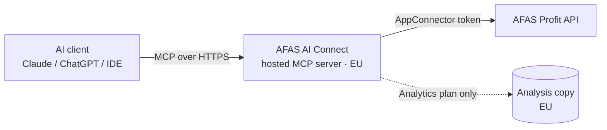

# How the connection works

You sign in through your browser once. Your AFAS environment is connected with an AppConnector token that is configured once in AFAS; no tokens are pasted into your AI client config. Every write is prepared as a draft you approve before it is
posted. The authoritative terms are in iWeb's AV/DPA.
